

<a href="https://elnarkennu.vercel.app"></a>

<a href="https://elnarkennu.vercel.app">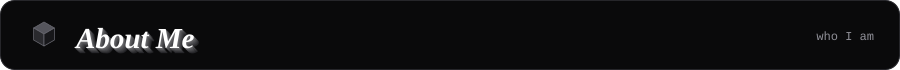</a>
<a href="https://elnarkennu.vercel.app">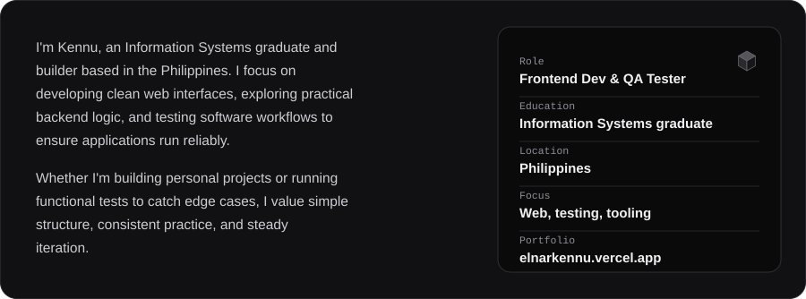</a>

<a href="https://elnarkennu.vercel.app">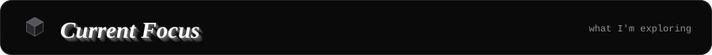</a>
<a href="https://elnarkennu.vercel.app">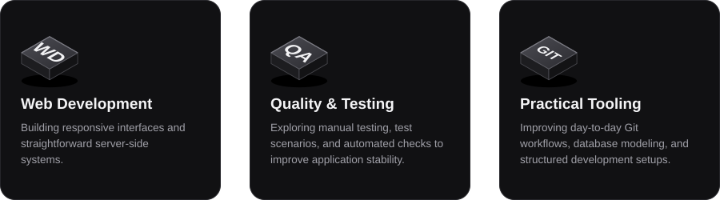</a>

<a href="https://github.com/elnarkennu16-440?tab=repositories">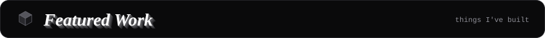</a>

<a href="https://github.com/elnarkennu16-440/MIRAMS-ENTERPRISE-SYSTEM">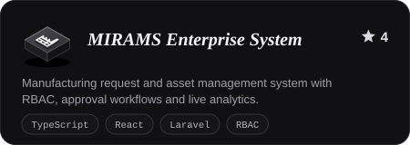</a>
<a href="https://github.com/elnarkennu16-440/NCAMIS-SHS">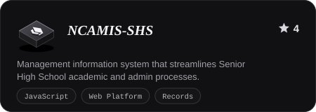</a>
<a href="https://github.com/elnarkennu16-440/E-COMMERCE-NOBLECLASSICS">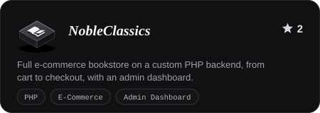</a>
<a href="https://github.com/elnarkennu16-440/BENTO-GRID-PORTFOLIO-TEMPLATE-1---REACTJS">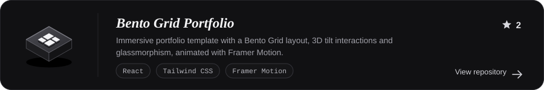</a>
<a href="https://github.com/elnarkennu16-440/3D-PARTICLE-SIMULATION">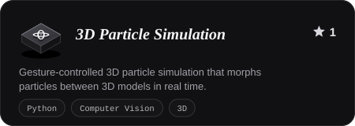</a>
<a href="https://github.com/elnarkennu16-440/3D-VISION-TRACK">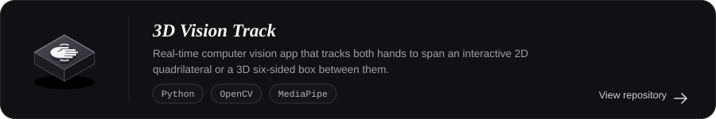</a>

<a href="https://elnarkennu.vercel.app">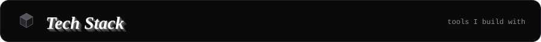</a>
<a href="https://elnarkennu.vercel.app">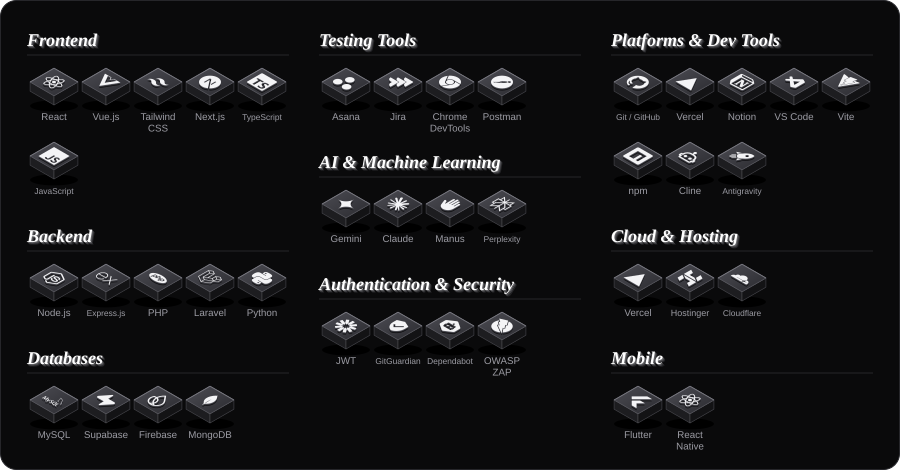</a>

<a href="https://github.com/elnarkennu16-440">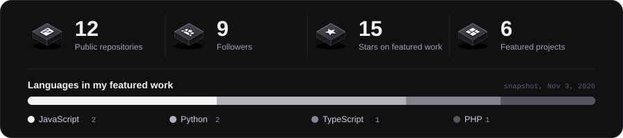</a>

<a href="https://elnarkennu.vercel.app">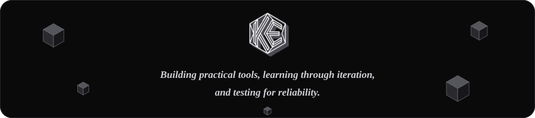</a>

